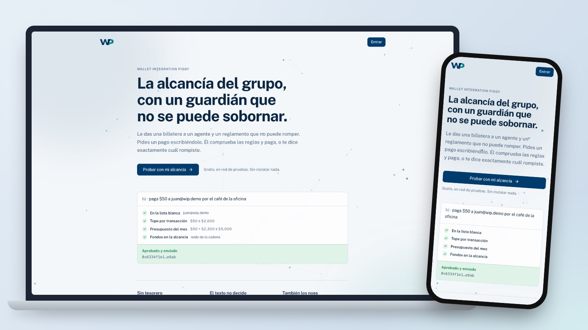
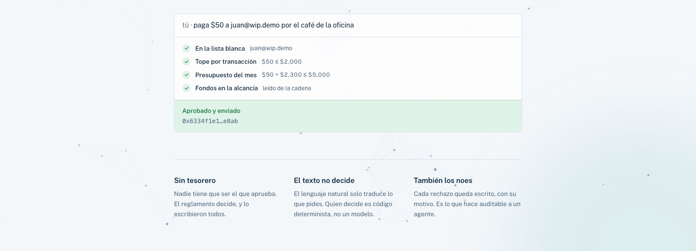
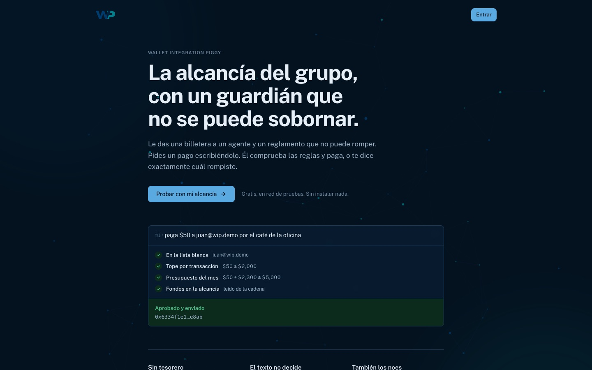
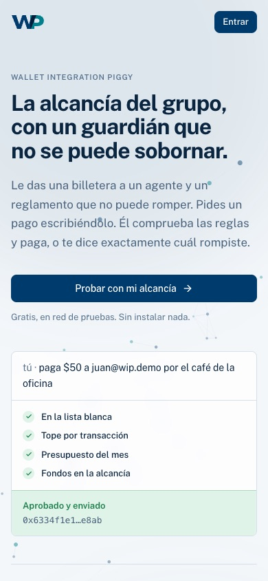
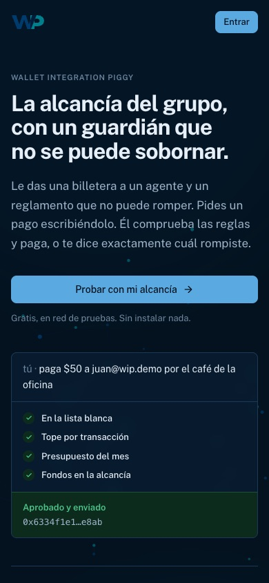
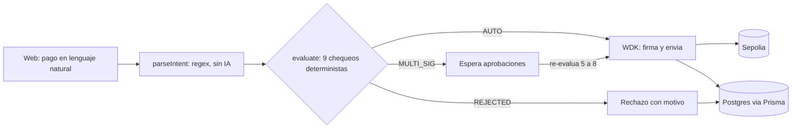

<div align="center">


# WIP · Wallet Integration Piggy

### La alcancía compartida del grupo, con un guardián que no se puede sobornar.

[](https://wip-piggy.vercel.app)
[](#-hackathon)
[](https://sepolia.etherscan.io/address/0xf95bee261a5f25634979be54173c1283d662c060)


<br/>



**[▶ Probar ahora](https://wip-piggy.vercel.app)** · **[Cómo funciona](#-cómo-funciona)** · **[Modelo de seguridad](#-modelo-de-seguridad)** · **[Detalle técnico](docs/TECNICO.md)**

</div>

---

## 🎯 El problema

Un grupo chico —una startup que todavía no tiene banco, una cooperativa, un equipo que le paga a freelancers— comparte un fondo y **alguien tiene que hacer de tesorero**: aprobar, pagar y llevar las cuentas. Darle esa tarea a un agente de IA suena bien hasta que te preguntas qué pasa si el modelo se equivoca con un monto o alguien lo convence de pagar algo que no debía.

## 💡 La solución: un agente con billetera y un reglamento que no puede romper

WIP le da una billetera propia a un agente, pero con un **contrato social explícito** que el grupo define por adelantado: topes, lista blanca, presupuesto mensual y aprobaciones de varias personas.

```
 Tú:     "paga $50 a juan@wip.demo por el café de la oficina"
 Agente: ✓ en la lista blanca · ✓ $50 ≤ tope de $2,000 · ✓ presupuesto del mes · ✓ fondos leídos de la cadena
         → Aprobado y enviado: 0x6334f1e1…e8ab
```

Un miembro pide un pago **escribiéndolo**. El agente lo valida contra el reglamento y **solo entonces** ejecuta una transferencia real en Sepolia. Cada pago y **cada rechazo** quedan en un registro que cualquier miembro puede leer.

## 🧭 Cómo se prueba

1. **Entra con Google** (Privy) y recibes tu propia alcancía en Sepolia, con cuatro integrantes y un reglamento.
2. **Un botón la fondea** con tokens de prueba desde un grifo interno: no tienes que buscar faucets.
3. **Pide un pago** en lenguaje natural y mira cómo el agente recorre los chequeos uno por uno.
4. **Cambia de persona** para aprobar o vetar los pagos que necesitan varias firmas.

Las transferencias son reales: cada una deja un hash comprobable en Etherscan.

<table>
<tr>
<td width="50%"><p align="center"><sub>El agente explica qué revisó antes de pagar.</sub></p></td>
<td width="50%"><p align="center"><sub>Modo oscuro.</sub></p></td>
</tr>
<tr>
<td width="50%" align="center"><p align="center"><sub>En el celular.</sub></p></td>
<td width="50%" align="center"><p align="center"><sub>En el celular, modo oscuro.</sub></p></td>
</tr>
</table>

<sub>Las pantallas del panel (alcancía, solicitud y reglamento) requieren iniciar sesión, por eso aquí solo aparece la portada pública.</sub>

## 🧠 Cómo funciona



**El parser nunca decide.** [`lib/parse.ts`](lib/parse.ts) solo traduce el texto a `{ amount, toEmail, reason }`. Si es ambiguo (dos cifras, dos correos, ningún beneficiario) **pide reformular en vez de adivinar**. La decisión la toma [`lib/rules.ts`](lib/rules.ts): una función pura sobre `(request, rules, state)`, sin red ni base de datos, con pruebas.

## 🔐 Modelo de seguridad

### Los 9 chequeos

Corren en este orden exacto. El primero que falla corta la evaluación, y el
`decisionLog` termina justo ahí — que es lo que la interfaz muestra en rojo.

| # | Chequeo | Qué verifica |
|---|---|---|
| 1 | `beneficiary_resolvable` | El correo existe y tiene dirección registrada |
| 2 | `beneficiary_in_allowlist` | Está en la lista blanca del reglamento |
| 3 | `not_self_payment` | Quien pide no es quien recibe |
| 4 | `amount_valid` | Número positivo, finito, máximo 2 decimales |
| 5 | `max_single_tx` | No supera el tope duro por transacción |
| 6 | `daily_limit` | Lo ejecutado hoy más este monto |
| 7 | `monthly_budget` | Lo ejecutado este mes más este monto |
| 8 | `onchain_balance` | El balance **real leído del CLI** alcanza |
| 9 | `approval_tier` | Decide la vía: automático, varias firmas o administrador |

**Invariantes que el código garantiza**

- Un `Payment` solo pasa a `EXECUTING` desde `APPROVED`. Nunca desde
  `PENDING_APPROVAL` directo.
- **Quien pide un pago no puede aprobarlo.** Se comprueba en la API, no solo
  escondiendo el botón: una llamada directa a `/api/payments/[id]/approve`
  responde `403`.
- Una persona vota una sola vez — lo fuerza un `@@unique` en la base.
- Un solo veto manda el pago a `REJECTED` de inmediato.
- Los cálculos de presupuesto cuentan solo pagos en `SUCCESS` y `EXECUTING`.
  Los rechazados nunca consumen presupuesto.
- **Antes de ejecutar se re-evalúan los chequeos 5 a 8.** Entre que se pidió el
  pago y que se aprobó, el balance pudo cambiar.
- `status = 'EXECUTING'` se persiste **antes** de llamar a la cadena: si el
  proceso muere a mitad, queda rastro.
- **Nunca se reintenta automáticamente una transferencia fallida.** Un pago que
  se manda dos veces por un retry es mucho peor que uno que falla y avisa.

Las pruebas del motor están en [`lib/rules.test.ts`](lib/rules.test.ts) (15 casos con `node:test`, `npm test`): `$50` → automático · `$400` → dos firmas · `$3,000` → rechazado por tope · beneficiario fuera de la lista → rechazado · quien pide intenta aprobar → bloqueado.

## 🔍 Qué es real y qué no

| Real | De demo |
|:--|:--|
| Billeteras derivadas con WDK, con direcciones reales en Sepolia | El token que se mueve es un ERC-20 propio (ver abajo) |
| Transferencias firmadas y enviadas, con `txHash` verificable | Los cuatro integrantes de cada alcancía se crean al entrar |
| Balance e historial leídos de la cadena, nunca de la base | Custodia: una seed maestra en el servidor (solo testnet) |
| El motor de reglas aprueba, rechaza y bloquea de verdad | |

## 🪙 Red y token

> ### ⚠️ El token de la demo es un mock, y hay que decirlo claro
>
> Las transferencias que se ven en el video mueven un **ERC-20 propio**, no el
> USD₮ de Tether:
>
> **`0xf95bee261a5f25634979be54173c1283d662c060`** · 6 decimales · Sepolia
> · [ver en Etherscan](https://sepolia.etherscan.io/address/0xf95bee261a5f25634979be54173c1283d662c060)
>
> Las transacciones son reales y verificables. El token no es el de Tether.

**Por qué.** El USD₮ de testnet en Sepolia existe y `@tetherto/wdk-cli` lo trae
registrado de fábrica en `0xd077A400968890Eacc75cdc901F0356c943e4fDb`
([verificable](https://sepolia.etherscan.io/token/0xd077A400968890Eacc75cdc901F0356c943e4fDb):
Tether USD, 6 decimales, 200M de supply, 1 670 holders):

```bash
npx wdk token info --network sepolia --token usdt --json
```

Lo que no encontramos fue **cómo obtenerlo**. Los faucets que las bases mencionan
—Pimlico y Candide— no están accesibles públicamente, y la doc del CLI no cubre
el fondeo. Sin fondos no hay demo, así que se tomó el plan B que el propio brief
contempla: desplegar un ERC-20 con los mismos 6 decimales y **documentarlo de
forma prominente** en vez de hacer pasar por USD₮ el token de otro emisor.

| | |
|---|---|
| Red | **Sepolia** testnet |
| Token de la demo | [`0xf95bee26…c060`](https://sepolia.etherscan.io/address/0xf95bee261a5f25634979be54173c1283d662c060) — mock, 6 decimales |
| USD₮ real de Sepolia | [`0xd077A400…4fDb`](https://sepolia.etherscan.io/token/0xd077A400968890Eacc75cdc901F0356c943e4fDb) — soportado, sin fondear |
| Contrato del mock | [`contracts/TestUSDT.sol`](contracts/TestUSDT.sol) |

**Cambiar de uno a otro es una variable de entorno**, no una refactorización: el
código referencia el token por su nombre en el registro del CLI, nunca por una
dirección pegada a mano. Con fondos de USD₮ real basta con `WDK_TOKEN="usdt"`.

```bash
npx wdk token add contracts/token-spec.json   # registra el mock como `testusdt`
```

## ⛓️ Pruebas en cadena

Estas transacciones salieron del código de este repo y existen en Sepolia:

| Qué | Hash |
|---|---|
| Despliegue del token | [`0x3a1e144c…3985`](https://sepolia.etherscan.io/tx/0x3a1e144c6fa0e520749061100da7301c39a7acd7ae4f7efb1db883877a453985) |
| Transferencia manual desde el CLI | [`0x0b5f567b…7b42`](https://sepolia.etherscan.io/tx/0x0b5f567bf1ae6eb42a08fefcafb09d3031394a75c26728e9e25851e878f57b42) |
| **Pago pedido en lenguaje natural** | [`0x6334f1e1…e8ab`](https://sepolia.etherscan.io/tx/0x6334f1e1147fd48ed04eb295b88f425f5fd2726b87b42a4265aa6dfbfc45e8ab) |

El último es el que cuenta: alguien escribió *"paga $50 a juan@wip.demo por el
café de la oficina"*, el motor corrió sus nueve chequeos, resolvió `AUTO`, y el
agente movió 50 USD₮ a la dirección de Juan. Sin intervención humana entre la
frase y la firma.

## 🛠️ Stack

| Capa | Tecnología |
|:--|:--|
| Web | Next.js 16 (App Router) · React 19 · TypeScript estricto · Tailwind CSS 4 · Motion · Recharts |
| Identidad | Privy (Google, correo o billetera externa) |
| Billetera | Tether WDK: `@tetherto/wdk-wallet-evm` (desplegado) y `@tetherto/wdk-cli` (local) |
| Datos | Postgres vía Prisma 7 (probado sobre Supabase) · validación con `zod` |
| Red | Sepolia testnet |

## 🚀 Correrlo en tu compu

```bash
git clone https://github.com/ALFA117/wip-wallet-integration-piggy.git
cd wip-wallet-integration-piggy
npm install
cp .env.example .env     # y rellena las variables
npm run db:push
npm run seed
npm run dev
```

Node 22.18.0 o superior (lo exige `@tetherto/wdk-cli`; está fijado en `.nvmrc`). Con `WDK_DRY_RUN=1` la interfaz corre sin billetera, con balance simulado y transferencias deshabilitadas.

<details>
<summary><b>Comandos útiles</b></summary>

| Comando | Qué hace |
|---|---|
| `npm test` | Pruebas del motor de reglas |
| `npm run db:push` · `npm run seed` | Crea las tablas · siembra datos |
| `npm run db:check` | Revisa la conexión a la base |
| `npm run wdk:check` | Verifica la integración con WDK (`-- --send 1 0xDIRECCION` hace una transferencia real) |
| `npm run build` · `npm run lint` | Build y ESLint |

</details>

La integración con WDK línea por línea, los dos backends de billetera, las variables de entorno, la API y la escalabilidad están en **[docs/TECNICO.md](docs/TECNICO.md)**.

## 🏆 Hackathon

Construido para el **Aleph Hackathon 2026**, track de **WDK** (Wallet Development Kit de Tether).

## 📋 Estado

- [x] Modelo de datos y persistencia
- [x] Wrapper de WDK con las 4 funciones, verificado contra el CLI real
- [x] Parser de lenguaje natural
- [x] Motor de reglas con los 9 chequeos + 15 tests
- [x] Las 6 rutas API
- [x] Interfaz: dashboard, solicitud con `decisionLog` animado, detalle, reglamento
- [x] Billetera fondeada y `txHash` verificado en Etherscan
- [ ] Video de demo

> **Límites, con honestidad:** es un prototipo de fin de semana. Para producción faltaría custodia con hardware o MPC, firma en el dispositivo de cada miembro, roles más finos que ADMIN/MEMBER y recuperación de billetera.

---

<div align="center">

**Le das una billetera a un agente, pero con un contrato social que no puede romper.**

Transferencias reales en la testnet de Sepolia. El dinero no tiene valor.

</div>
